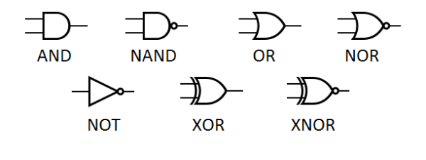

# 2. Boolean Logic and Logic Gates

Boolean logic explains how computers make decisions using two logical values. **Logic gates** implement these operations in hardware, and combinations of gates form circuits that calculate, compare, control, and store information.

## 2.1 From Binary Data to Boolean Logic

A **Boolean variable** can take one of two values:

- `0` — false (`False`), often associated with a low logical level.
- `1` — true (`True`), often associated with a high logical level.

The meaning depends on context. For example, `1` could mean that a sensor detects movement, that a user is authenticated, or that a particular bit is set. The bit itself does not inherently mean *true* or *on*.

**Boolean algebra** is a mathematical system for combining and transforming two-valued expressions. Its three fundamental operations are **NOT**, **AND**, and **OR**. Other operations, including XOR, NAND, and NOR, can be constructed from them.

### Logical Values vs Physical Voltages

Digital hardware uses physical signals to represent logical values. In **positive logic**, a low voltage range represents `0` and a high voltage range represents `1`. In **negative logic**, the assignments are reversed.

A logical `0` is **not necessarily exactly 0 volts**, and a logical `1` is **not necessarily a particular fixed voltage**. The valid ranges depend on the circuit's technology and supply voltage. The university laboratory notes emphasize that these ranges have tolerances.

| Abstraction | Example | Meaning |
|---|---|---|
| Boolean value | `1` | A logical state |
| Binary digit | `1` | A symbol in a representation |
| Electrical signal | Voltage within an accepted high range | One possible physical implementation of logical `1` in positive logic |

The same logical operation can be implemented using transistors, relays, or other technologies. **The truth table describes the behavior independently of the implementation.**

## 2.2 Boolean Expressions and Notation

A **Boolean expression** combines variables and logical operators to produce a Boolean result.

| Operation | Common notation | Meaning |
|---|---|---|
| NOT | `¬A`, `A̅`, `!A` | Negates `A` |
| AND | `A ∧ B`, `A · B`, `AB` | Both must be true |
| OR | `A ∨ B`, `A + B` | At least one must be true |
| XOR | `A ⊕ B` | Exactly one of two inputs is true |

In Boolean algebra, `+` means **OR**, not ordinary integer addition: `1 + 1 = 1` in Boolean OR. Similarly, `·` means **AND**.

### Parentheses and Precedence

Parentheses determine which parts of an expression are evaluated together.

Consider:

- `(A OR B) AND C` — `C` must be true, and at least one of `A` or `B` must be true.
- `A OR (B AND C)` — either `A` is true, or both `B` and `C` are true.

These expressions are **not equivalent**.

**Use parentheses whenever the intended grouping might be unclear.**

### Example 1: Evaluate `(A OR B) AND C`

Given `A = 0`, `B = 1`, and `C = 1`:

1. Evaluate the parentheses: `0 OR 1 = 1`.
2. Evaluate AND: `1 AND 1 = 1`.

**Result: `1`.**

### Example 2: Evaluate `A OR (B AND C)`

Given `A = 0`, `B = 1`, and `C = 0`:

1. Evaluate the parentheses: `1 AND 0 = 0`.
2. Evaluate OR: `0 OR 0 = 0`.

**Result: `0`.**

## 2.3 Truth Tables

A **truth table** lists the output of a Boolean expression for **every possible combination of input values**. It is one of the most reliable ways to verify a logical expression or circuit.

For `n` independent Boolean inputs, there are:

$$2^n$$

possible input combinations.

| Inputs | Number of combinations |
|---:|---:|
| 1 | 2 |
| 2 | 4 |
| 3 | 8 |
| 4 | 16 |

For two inputs, the combinations are `00`, `01`, `10`, and `11`. For three inputs, there are eight rows, from `000` to `111`.

A truth table describes **what** a circuit does (or does not), not necessarily **how** it is built.

---

## 2.4 Boolean Algebra Laws

Boolean algebra provides rules for rewriting expressions without changing their truth values. These laws are important when analyzing or simplifying circuits.

| Law | AND form | OR form |
|---|---|---|
| Identity | `A AND 1 = A` | `A OR 0 = A` |
| Domination | `A AND 0 = 0` | `A OR 1 = 1` |
| Idempotence | `A AND A = A` | `A OR A = A` |
| Complement | `A AND NOT A = 0` | `A OR NOT A = 1` |
| Commutative | `A AND B = B AND A` | `A OR B = B OR A` |
| Associative | `(A AND B) AND C = A AND (B AND C)` | `(A OR B) OR C = A OR (B OR C)` |
| Absorption | `A AND (A OR B) = A` | `A OR (A AND B) = A` |

**Double negation:**

$$\neg(\neg A) = A$$

**Distributive laws:**

$$A \land (B \lor C) = (A \land B) \lor (A \land C)$$

$$A \lor (B \land C) = (A \lor B) \land (A \lor C)$$

Unlike ordinary arithmetic, Boolean algebra has **both** distributive forms.

### Example 1: Simplify `A AND (A OR B)`

By absorption:

`A AND (A OR B) = A`.

If `A = 0`, both sides are `0`. If `A = 1`, `(A OR B)` is necessarily `1`, so both sides are `1`.

### Example 2: Simplify `A OR (A AND B)`

By absorption:

`A OR (A AND B) = A`.

If `A = 1`, the whole expression is `1`. If `A = 0`, the AND term is `0`, so the whole expression is `0`.

---

## 2.5 De Morgan's Laws

**De Morgan's laws** explain how negation interacts with AND and OR:

$$\neg(A \land B) = (\neg A) \lor (\neg B)$$

$$\neg(A \lor B) = (\neg A) \land (\neg B)$$

In words:

- **NOT (A AND B)** means **(NOT A) OR (NOT B)**.
- **NOT (A OR B)** means **(NOT A) AND (NOT B)**.

Notice that **the operator changes** when negation is distributed over the entire expression: AND becomes OR, and OR becomes AND.

### Example 1: Negating a Login Requirement

Original condition:

`ValidPassword AND ValidCode`

Negated condition:

`NOT (ValidPassword AND ValidCode)`

Using De Morgan's law:

`(NOT ValidPassword) OR (NOT ValidCode)`

The login requirement fails if **at least one** requirement is missing.

### Example 2: Negating an Alarm Condition

Original condition:

`SmokeDetected OR HeatDetected`

Negated condition:

`NOT (SmokeDetected OR HeatDetected)`

Using De Morgan's law:

`(NOT SmokeDetected) AND (NOT HeatDetected)`

The alarm condition is false only if **neither** trigger is present.

### Verify De Morgan's First Law with a Truth Table

| A | B | A AND B | NOT (A AND B) | NOT A | NOT B | (NOT A) OR (NOT B) |
|---:|---:|---:|---:|---:|---:|---:|
| 0 | 0 | 0 | **1** | 1 | 1 | **1** |
| 0 | 1 | 0 | **1** | 1 | 0 | **1** |
| 1 | 0 | 0 | **1** | 0 | 1 | **1** |
| 1 | 1 | 1 | **0** | 0 | 0 | **0** |

The two highlighted result columns have identical values for every input combination, so the expressions are equivalent.

---

## 2.6 The NOT Gate (Negation)

**NOT** reverses a logical value. It has **one input** and **one output**.

$$Y = \neg A$$

| A | NOT A |
|---:|---:|
| 0 | 1 |
| 1 | 0 |

A NOT gate is also called an **inverter**. 

### Example 1: Invert a Sensor State

A sensor reports `A = 1` when a door is closed. If `Y = NOT A`, then `Y = 0`: the condition “door is not closed” is false.

### Example 2: Invert a Permission Flag

A flag reports `A = 0` when a feature is disabled. `NOT A = 1`, so the statement “the feature is not enabled” is true.

---

## 2.7 The AND Gate (Logical Conjunction)

**AND** produces `1` only when **all its inputs are `1`**.

$$Y = A \land B = A \cdot B$$

| A | B | A AND B |
|---:|---:|---:|
| 0 | 0 | 0 |
| 0 | 1 | 0 |
| 1 | 0 | 0 |
| 1 | 1 | 1 |

A useful physical analogy is **two normally open switches connected in series**: current can flow only when both are closed. 

### Example 1: Authentication

A login succeeds only if the password is correct (`A`) **and** multifactor verification succeeds (`B`).

For `A = 1`, `B = 0`:

`1 AND 0 = 0` — access is denied.

### Example 2: Safety Interlock

A machine may operate only when its guard is closed (`A`), and the start command is active (`B`).

For `A = 1`, `B = 1`:

`1 AND 1 = 1` — the Boolean permission condition is satisfied; the machine can operate.

## 2.8 The OR Gate (Logical Disjunction)

**OR** produces `1` when **at least one input is `1`**. This is **inclusive OR**: when both inputs are `1`, the output is still `1`.

$$Y = A \lor B = A + B$$

| A | B | A OR B |
|---:|---:|---:|
| 0 | 0 | 0 |
| 0 | 1 | 1 |
| 1 | 0 | 1 |
| 1 | 1 | 1 |

A physical analogy is **two normally open switches connected in parallel**: either closed switch provides a path.

### Example 1: Alarm Conditions

An alarm should activate if smoke is detected (`A`) **or** excessive heat is detected (`B`).

For `A = 0`, `B = 1`:

`0 OR 1 = 1` — the alarm condition is true so it should activate.

### Example 2: Alternative Access Methods

A system accepts a valid badge (`A`) or a valid temporary code (`B`).

For `A = 1`, `B = 1`:

`1 OR 1 = 1` — access is permitted; both conditions being true does not cancel the result.

## 2.9 The XOR Gate (Exclusive OR)

**XOR** produces `1` when **exactly one of its two inputs is `1`**, or simply when the inputs differ.

$$Y = A \oplus B$$

| A | B | A XOR B |
|---:|---:|---:|
| 0 | 0 | 0 |
| 0 | 1 | 1 |
| 1 | 0 | 1 |
| 1 | 1 | 0 |

This is different from inclusive OR: `1 OR 1 = 1`, whereas `1 XOR 1 = 0`.

XOR can be expressed using NOT, AND, and OR:

$$A \oplus B = (A \land \neg B) \lor (\neg A \land B)$$

### Example 1: Compare Two Bits

For `A = 1`, `B = 0`, the bits differ:

`1 XOR 0 = 1`.

For `A = 1`, `B = 1`, the bits match:

`1 XOR 1 = 0`.

## 2.10 NAND, NOR, and XNOR

These gates negate the outputs of other logical operations.

### NAND (NOT AND)

$$Y = \neg(A \land B)$$

NAND outputs `0` **only when both inputs are `1`**.

| A | B | A NAND B |
|---:|---:|---:|
| 0 | 0 | 1 |
| 0 | 1 | 1 |
| 1 | 0 | 1 |
| 1 | 1 | 0 |

### NOR (NOT OR)

$$Y = \neg(A \lor B)$$

NOR outputs `1` **only when both inputs are `0`**.

| A | B | A NOR B |
|---:|---:|---:|
| 0 | 0 | 1 |
| 0 | 1 | 0 |
| 1 | 0 | 0 |
| 1 | 1 | 0 |

### XNOR (NOT XOR)

$$Y = \neg(A \oplus B)$$

XNOR outputs `1` when **the two inputs are equal**. It does not matter if they are both `1` or both `0`.

| A | B | A XNOR B |
|---:|---:|---:|
| 0 | 0 | 1 |
| 0 | 1 | 0 |
| 1 | 0 | 0 |
| 1 | 1 | 1 |

### Example 1: NAND

For `A = 1`, `B = 1`:

`AND = 1`, so `NAND = NOT 1 = 0`.

### Example 2: NOR

For `A = 0`, `B = 0`:

`OR = 0`, so `NOR = NOT 0 = 1`.

## 2.11 Reading Logic Gate Symbols

The book and university laboratory use common **American-style logic gate symbols**.

| Gate | Visual identification |
|---|---|
| AND | Flat left side, rounded right side |
| OR | Curved input side, pointed curved output side |
| XOR | OR shape with an extra curved line at the input |
| NOT | Triangle with a small output circle |
| NAND | AND shape with a small output circle |
| NOR | OR shape with a small output circle |
| XNOR | XOR shape with a small output circle |

